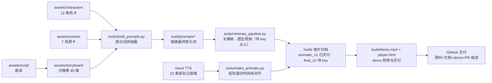

# 架构设计文档（琅琊榜 EP1 × MiniMax 直连产线）

> 比赛要求：架构设计文档需包含模块规格与分工。本文按六层模块描述产线；
> 分工按 1/2/3 人三档给出，实际参赛时删掉未用档位。
>
> **决策记录（2026-10-25）**：原方案生成执行层为 XCanvas/灯虹平台。参赛网络环境下
> 平台不可达（本机 fake-IP 代理对该域阻断、内网网关 key 无法登录平台，两日实测），
> 经 owner 决策将生成层切换为 MiniMax API 直连（tools/minimax_pipeline.py），
> 其余五层不变——这正是「创作决策与生成执行分离」架构的价值：换执行层零改动资产层。

## 1. 系统总览

核心思想：**创作决策与生成执行分离**。剧本、角色、场景、分镜全部是仓库里的
结构化数据文件（唯一事实来源），XCanvas（灯虹）只承担生成执行；提示词由
`tools/build_prompts.py` 从数据文件确定性拼装——同一个仓库状态永远可以复现
同一批提示词，改任何一层只影响对应下游。



## 2. 模块规格

| 模块 | 位置 | 规格 | 输入 → 输出 |
|---|---|---|---|
| 剧本层 | `assets/script/` | 分场+钩子结构+改编幅度说明，人读 | 原剧 EP1 剧情 → 短剧剧本 |
| 角色资产层 | `assets/characters.json` | 12 卡；appearance_prompt 为锁定锚串；含 TTS 音色与降级策略 | 剧本 → 角色视觉设定 |
| 场景资产层 | `assets/scenes.json` | 7 卡；scene_prompt 锁定时段/色板/光线 | 剧本 → 场景视觉设定 |
| 分镜层 | `assets/storyboard/` | 40 镜；每镜 12 字段（景别/运镜/时长/台词/fallback…）；schema 版本化 | 剧本+资产 → 可执行镜头单 |
| 提示词层 | `tools/build_prompts.py` | 风格基石+场景锚+角色锚+可变段 四段式拼装；引用校验 | 数据文件 → `build/prompts/` |
| 配音层 | cloud TTS（已就绪） | 22 条音轨（11 旁白+11 台词）分角色调语速/音高，48kHz | 剧本台词 → `build/audio/` |
| 生成层 | `tools/minimax_pipeline.py`（待 key） | probe→images(37)→videos 断点续传；SSRF 加固；DoH 直连绕代理 | 提示词 → 关键帧/镜头视频 |
| 合成层 | `make_animatic.py` + `assemble2` | 音轨驱动时长对齐（143.5s→186.8s，19 镜自动拉伸）；key 后以真实镜头替换分镜卡 | 镜头素材+音轨 → 成片 |
| 交付层 | GitHub | 源码+运行说明+本文档+demo 视频，PR 全程留痕 | 全部 → 比赛提交 |

## 3. 数据契约（关键 schema 字段）

- 角色卡：`appearance_anchors[3]`（人读）+ `appearance_prompt`（机器拼装用，必须
  与锚点一致）+ `tts` + `first_shot` + `cost_note`（省一致性成本的规避策略）。
- 分镜：`chars[]`/`scene` 必须引用存在的 id（build 脚本校验，引用错误即报错退出）；
  `gen_mode ∈ {image_first, direct_video, post_only}`；每镜必有 `fallback`。

## 4. 关键设计决策

1. **提示词确定性拼装**而非手写：消除「同一角色每镜描述漂移」这一最大翻车源。
2. **省成本角色策略**：不露脸/背影/手替/画外音四档规避策略写进角色卡，减少
   高一致性要求的正脸镜头数量（全片需严格人脸一致的只有梅长苏、飞流等 6 人）。
3. **post_only 镜头**（字卡/闪回）不走生成，纯后期，规避 AI 文字乱码。
4. **先跑通 30 秒**再铺量，产线任何环节不可用都能在 1 小时内发现并整体降级。
5. **改编幅度诚实标注**（霓凰前置等 4 项），评委可直接核对。

## 5. 分工方案

- 1 人：本人全包；按 SOP 时间块串行。
- 2 人：A=资产+生成（定妆、关键帧、视频、一致性巡检）；B=剧本+剪辑+交付
  （分镜终审、TTS、合成、demo、文档）。仓库 PR 记录各自提交。
- 3 人：A=资产；B=生成+一致性；C=剪辑+交付。

## 6. 风险与降级

| 风险 | 概率 | 降级 |
|---|---|---|
| 平台 9:16 视频质量差 | 中 | 全片转 16:9，分镜 aspect 同步改 |
| 关键帧一致性不达标 | 中 | 加融图/多参考；降级为静帧+运镜动画成片 |
| 动作镜头崩坏 | 高 | fallback 拆镜/三连静帧/震屏（已写入每镜） |
| 时间不够铺完 40 镜 | 中 | 优先级：S2-08 定妆 > S2-05 动作 > S0 冷开场 > S4-08 强钩 > 其余；砍 S3-03/S4-06 |
| 10/26 前 platform 不可用 | 低 | 全链路换开源产线 drama-skills + MiniMax H3 适配器 |

## 7. 运行说明

```bash
python3 tools/build_prompts.py    # 无第三方依赖，Python 3.9+；输出与校验报告
```

其余子命令（make_animatic / minimax_pipeline / make_demo）见 README「快速开始」。

## 8. 当前交付状态（2026-10-25）

| 交付物 | 状态 |
|---|---|
| 剧本/角色卡/场景卡/分镜表/提示词 | ✅ 全部入库，可复跑 |
| 22 条 TTS 音轨 | ✅ 完成（分角色调参） |
| 关键帧 37 张（gpt-image-2） | ✅ `build/frames_jpg/`（PNG 母版本地） |
| 镜头视频 37 条（minimax-h3-max t2v） | ✅ 768×1344，断点续跑+限流退避 |
| 正式成片 | ✅ `build/final_v2.mp4`（186.75s / 1080×1920 / QC pass，39/40 真实镜头，唯一纯后期镜=片尾二创声明字卡） |
| 动态分镜 v1（对照版） | ✅ `build/animatic_v1.mp4` |
| demo 视频（72.3s） | ✅ `build/demo.mp4`（make_demo.py 可复跑） |
| 交付网页 | ✅ `player.html`（自动优先播放 v2） |
| 网关探测定谳（LLM-only 证据） | ✅ `tools/probe_gateway.py` + `docs/decisions.md` D2/D4 |
